nelindanila7@gmail.com · Moscow, hybrid or remote · English B2 · <a href="https://github.com/spasster/Portfolio">на русском →</a>

  

## Projects

  
  
  
  

## Stack

    
    
  

Alertmanager · Loki · Tempo · Alloy · Blackbox · Helm · Istio · Chaos Mesh · k6 · ClickHouse · BullMQ · Socket.IO · aiogram

 

<picture>
  <source media="(prefers-color-scheme: dark)" srcset="https://raw.githubusercontent.com/spasster/spasster/output/github-snake-dark.svg">
  
</picture>

